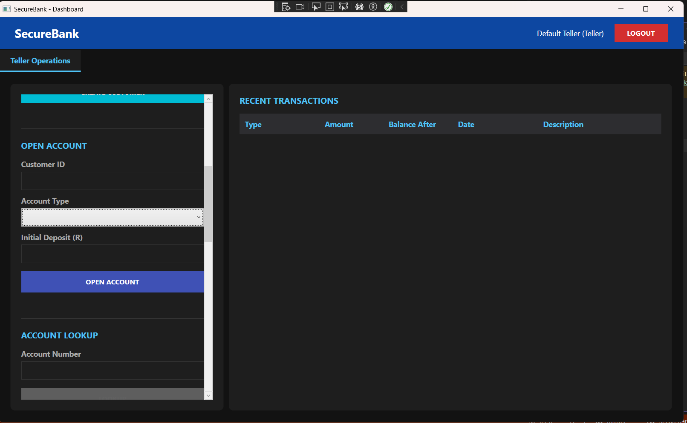
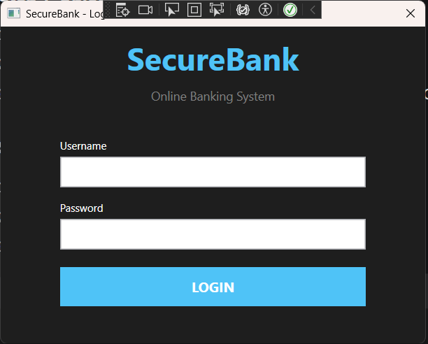
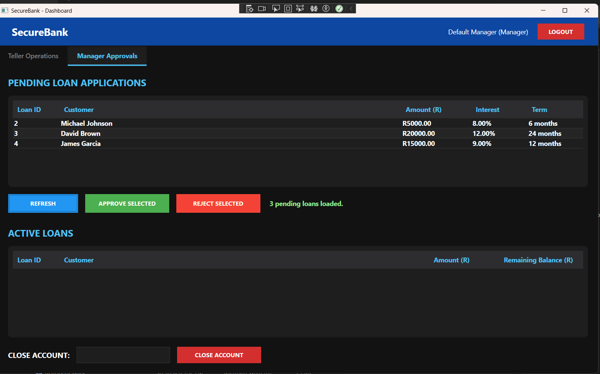
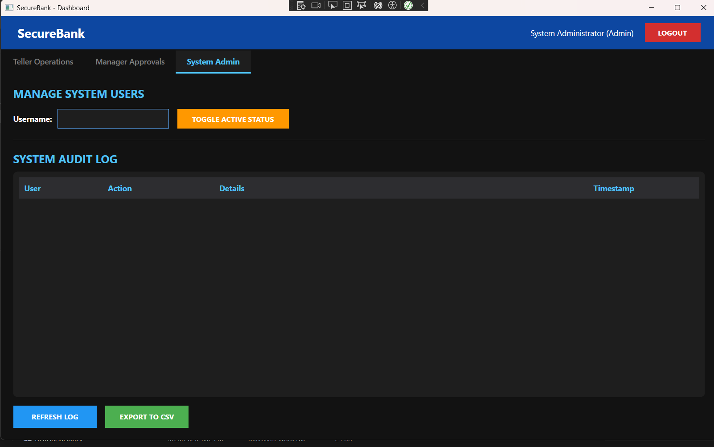

# SecureBank - Enterprise Banking System

A fully functional, secure client-server banking application built with **C#**, **WPF**, and **SQL Server**. Designed to demonstrate enterprise architecture, concurrent networking, and role-based access control.

## 🏦 The Project
Most student projects are single-user CRUD apps. Real banking systems require multiple clients connecting to a central server, secure role-based access, concurrent database transactions, and a complete audit trail of every action. This project simulates a real-world banking terminal environment.

## 🏗️ Architecture
- **Server (C# Console):** A multi-threaded TCP server that handles concurrent client connections, processes commands, and protects database integrity.
- **Client (C# WPF):** A modern, dark-themed desktop interface.
- **Database (SQL Server):** Relational storage for users, customers, accounts, transactions, and loans.
- **Security:** Passwords are hashed using SHA-256. The server enforces strict role-based authorization on every command.

### Login Screen

## 🔐 Role-Based Access Control (RBAC)
The application dynamically changes its UI and server permissions based on the logged-in user:
- **Teller:** Can create customers, open accounts, process deposits/withdrawals/transfers, and apply for loans.
- **Manager:** Has all Teller permissions, plus the ability to approve/reject loan applications, view active loans, and close accounts (only if the balance is zero).
- **Admin:** System-wide access. Can view the full system Audit Log, export logs to CSV, and disable/enable staff accounts.

### Manager Dashboard

### Admin Dashboard

## ⚙️ Core Features
- **Real-time TCP Networking:** Custom protocol for reliable client-server communication.
- **Data Integrity:** Closing a customer's account automatically rejects any of their pending loan applications.
- **Audit Log:** Every sensitive action (deposits, loan approvals, user toggles) is logged securely with a timestamp and user ID, viewable and exportable by the Admin.
- **Transaction Management:** Deposits, withdrawals, and transfers with strict balance validation.
- **Concurrency:** The server handles multiple clients simultaneously using multi-threading.

## 🛠️ Tech Stack
- **Language:** C# (.NET 10)
- **UI Framework:** WPF
- **Database:** SQL Server LocalDB
- **Data Access:** ADO.NET (`Microsoft.Data.SqlClient`)
- **IDE:** Visual Studio

## 🚀 How to Run

### Prerequisites
- Windows OS
- Visual Studio 2022 or later
- SQL Server LocalDB

### Setup
1. Clone the repository.
2. Open **SQL Server Object Explorer** in Visual Studio.
3. Run the `CreateDatabase.sql` script to create the schema, hash passwords, and seed 10 test customers.
4. Open the solution (`SecureBankServer.slnx`).
5. Build the solution (`Ctrl+Shift+B`).

### Running the App
1. Right-click `SecureBank.Server` → **Debug → Start New Instance**.
2. Right-click `SecureBank.Client` → **Debug → Start New Instance**.

### Default Login Credentials
- **Admin:** `admin` / `admin123`
- **Manager:** `manager1` / `manager123`
- **Teller:** `teller1` / `teller123`

## 📂 Project Structure
- `SecureBank.Server/` - TCP Listener, Client Handler, Business Logic.
- `SecureBank.Client/` - WPF UI (Login, Dashboard).
- `SecureBank.Shared/` - Models and Protocol shared between Client and Server.
- `Database/` - SQL schema creation scripts.

## 🧠 What I Learned
- Designing and implementing a custom TCP client-server protocol.
- Managing multi-threaded socket connections without race conditions.
- Implementing Role-Based Access Control (RBAC) across both UI and backend.
- Structuring an enterprise-scale WPF application with clean separation of concerns.
